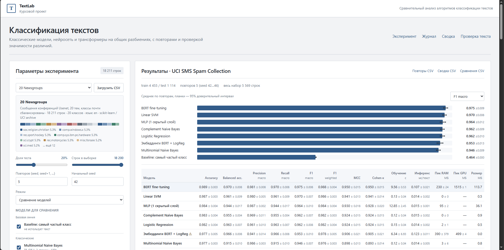
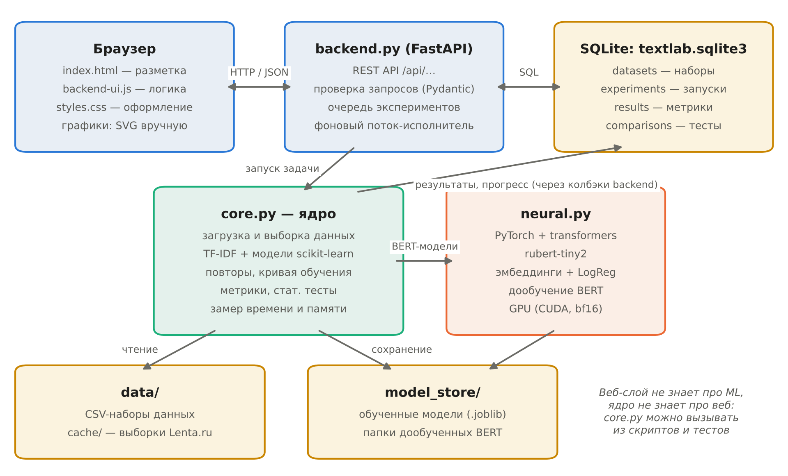

# TextLab

**Программный комплекс для сравнительного анализа алгоритмов машинного обучения в задачах классификации текстов.**

TextLab — локальное веб-приложение. Оно обучает классические модели, нейросеть и трансформеры **на одних и тех же разбиениях данных**, повторяет эксперимент на нескольких seed, считает метрики качества и затрат, проверяет статистическую значимость различий и сохраняет всё в SQLite.

Курсовой проект, 2026.



## Возможности

- 4 встроенных корпуса (SMS Spam, 20 Newsgroups, RuReviews, Lenta.ru) и загрузка своего CSV
- 8 моделей: от «всегда самый частый класс» до дообучения BERT на GPU
- повторный стратифицированный hold-out: среднее, стандартное отклонение и 95 % доверительный интервал
- режим кривой обучения: качество в зависимости от объёма обучающей выборки
- 8 метрик качества, метрики по классам и матрицы ошибок
- 5 метрик затрат: время обучения и инференса, пиковая RAM и видеопамять, размер модели
- скорректированный t-тест Nadeau–Bengio, тест Макнемара, поправка Холма
- журнал экспериментов в SQLite, выгрузка в CSV
- «Проверка текста»: классификация своего текста обученными моделями с объяснением по словам

## Стек

| Слой | Технологии |
|---|---|
| Сервер | Python 3.10+ (проверено на 3.12), FastAPI, Uvicorn, Pydantic |
| Хранение | SQLite (режим WAL) |
| Классическое ML | scikit-learn, NumPy, SciPy, pandas, joblib |
| Трансформеры (по желанию) | PyTorch, Hugging Face transformers, модель `cointegrated/rubert-tiny2` |
| Интерфейс | HTML, CSS, JavaScript без фреймворков, графики в SVG |

## Установка и запуск

Нужен **Python 3.10 или новее** (рекомендуется 3.12) и интернет при первом запуске: скачиваются зависимости и наборы данных.

```bash
git clone https://github.com/Kae1thas/textlab.git
cd textlab
```

### Windows

Двойной клик по `start.cmd` или в PowerShell:

```powershell
.\start.ps1
```

Скрипт создаёт виртуальное окружение `.venv`, ставит зависимости из `requirements.txt`, скачивает наборы данных и запускает сервер. Браузер откроется на http://127.0.0.1:8000.

Параметры: `.\start.ps1 -Port 8080 -NoBrowser -SkipData`.

### Linux / macOS

```bash
./start.sh          # порт по умолчанию 8000; другой: ./start.sh 8080
```

Откройте http://127.0.0.1:8000. Чтобы пропустить проверку наборов данных: `SKIP_DATA=1 ./start.sh`.

### Вручную

```bash
python -m venv .venv
.venv/bin/pip install -r requirements.txt     # Windows: .venv\Scripts\pip ...
.venv/bin/python prepare_data.py
.venv/bin/python -m uvicorn backend:app --host 127.0.0.1 --port 8000
```

Документация API (Swagger): http://127.0.0.1:8000/docs.

### Модели-трансформеры (необязательно)

Без PyTorch приложение работает полностью, кроме двух BERT-моделей: в интерфейсе они неактивны.

| Компьютер | Команда |
|---|---|
| Windows + видеокарта NVIDIA | `.\install-gpu.ps1` (PyTorch под CUDA 12.8, подходит и для RTX 50xx) |
| Windows без NVIDIA | `.\install-cpu.ps1` (обучать BERT на CPU долго, но «Проверка текста» работает) |
| Linux / macOS | `.venv/bin/pip install torch` (для NVIDIA — по инструкции с pytorch.org), затем `.venv/bin/pip install -r requirements-gpu.txt` |

Проверка после установки: `python tests/transformer_check.py`. Модель rubert-tiny2 (~120 МБ) скачается при первом использовании.

### Набор Lenta.ru

Lenta.ru (2 ГБ) автоматически не скачивается. Возьмите `lenta-ru-news.csv` из [yutkin/Lenta.Ru-News-Dataset](https://github.com/yutkin/Lenta.Ru-News-Dataset) и положите в `data/`. Без него остальные наборы работают как обычно.

## Использование

1. Выберите набор данных или загрузите свой CSV: разделитель и кодировка (UTF-8 / Windows-1251) определяются автоматически, столбцы текста и метки выбираются в форме.
2. Задайте долю теста, объём выборки, число повторов (для выводов — 5–10) и начальный seed.
3. Выберите режим «Сравнение моделей» или «Кривая обучения» и отметьте модели.
4. Нажмите «Поставить в очередь». Обучение идёт в фоне, прогресс и частичные результаты видны сразу, страницу можно закрыть.
5. Смотрите сводную таблицу, график с доверительными интервалами, значимость различий и матрицы ошибок. Выгрузите CSV для отчёта.
6. В разделе «Проверка текста» примените обученные модели к своему тексту.

## Модели

| Ключ | Модель | Параметры | Зачем |
|---|---|---|---|
| `dummy` | Baseline | всегда самый частый класс | нижняя граница; показывает, как обманывает accuracy |
| `nb` | Multinomial Naive Bayes | α = 0,5 | быстрая классика для текстов |
| `cnb` | Complement Naive Bayes | α = 0,5 | вариант NB для несбалансированных классов |
| `lr` | Logistic Regression | lbfgs, max_iter = 1000, `class_weight="balanced"` | сильный интерпретируемый стандарт |
| `svm` | Linear SVM | C = 1, `class_weight="balanced"` | исторически лучший метод для TF-IDF |
| `mlp` | MLP | 1 скрытый слой из 128 нейронов, early stopping | нужна ли нелинейность поверх TF-IDF |
| `emb_lr` | Эмбеддинги BERT + LogReg | сеть заморожена, mean pooling | дешёвое использование предобученной модели |
| `bert` | Дообучение BERT | 3 эпохи, AdamW 5e-5, warmup 10 %, bf16, веса классов | современный подход |

Признаки классических моделей — TF-IDF униграмм и биграмм (`min_df=2`, `sublinear_tf`, до 100 000 признаков; у MLP — 20 000). TF-IDF строится только на обучающей части. Трансформер по умолчанию — `cointegrated/rubert-tiny2`; в интерфейсе можно указать любую модель с Hugging Face Hub (готовые варианты: `DeepPavlov/rubert-base-cased`, `xlm-roberta-base` и др.).

## Методика

- **Повторный стратифицированный hold-out.** Повтор *r* делит данные с seed + *r*. Внутри повтора все модели получают одно и то же разбиение, поэтому сравнения парные.
- **Метрики качества:** Accuracy, Balanced Accuracy, Precision / Recall / F1 macro, F1 weighted, MCC, Cohen's κ, F1 по классам, матрица ошибок. Главная метрика — Macro F1.
- **Метрики затрат:** время обучения (включая TF-IDF), время инференса на текст, пиковый прирост RAM процесса (опрос раз в 20 мс), пик видеопамяти, размер модели.
- **Значимость различий** для каждой пары моделей:
  - скорректированный t-тест повторных разбиений по Macro F1 (Nadeau & Bengio, 2003): обычный парный t-тест на пересекающихся обучающих выборках занижает p-value;
  - тест Макнемара на тесте первого повтора;
  - поправка Холма на множественные сравнения.
- **Кривая обучения.** Тест общий для всех размеров, обучающие выборки вложены друг в друга. Поэтому рост качества с объёмом измеряется на одном и том же тесте.

## Архитектура



```
textlab/
├── backend.py          FastAPI: REST API, SQLite, очередь и фоновый исполнитель экспериментов
├── core.py             ядро без веб-части: данные, TF-IDF, модели, метрики, статистика, прогон эксперимента
├── neural.py           трансформеры (PyTorch + transformers), подключаются только при наличии библиотек
├── prepare_data.py     скачивание открытых наборов данных в data/
├── static/             интерфейс: index.html, backend-ui.js, styles.css
├── tests/              сквозной тест API, проверка трансформеров, генератор синтетики
├── results/            результаты экспериментов курсовой: отчёт, CSV, рисунки
├── docs/               изображения для README
├── start.ps1, start.cmd, start.sh      установка и запуск
├── install-gpu.ps1, install-cpu.ps1    установка PyTorch и transformers (Windows)
└── requirements*.txt
```

Создаются при работе (в git не попадают): `data/` (наборы и кэш выборок), `model_store/` (обученные модели), `textlab.sqlite3` (база). Каталог для них можно переопределить переменной окружения `TEXTLAB_HOME`.

Почему так:

- **Ядро отделено от веба.** `core.py` получает конфигурацию эксперимента и сообщает о прогрессе через колбэки, поэтому его можно вызвать из скрипта или теста без сервера.
- **Одна очередь и один исполнитель.** Эксперименты выполняются по одному, чтобы замеры времени не искажались параллельной нагрузкой. HTTP-запрос только ставит задачу в очередь, а интерфейс опрашивает прогресс.
- **SQLite.** Однопользовательский локальный стенд: база — один файл, не нужен сервер СУБД, журнал переносится копированием. Режим WAL позволяет читать результаты во время записи.
- **Без фронтенд-фреймворка.** Одна страница, небольшой объём логики; сборка и зависимости не нужны.

### База данных

| Таблица | Одна запись | Содержимое |
|---|---|---|
| `datasets` | набор данных | путь, источник, язык, распределение классов |
| `experiments` | запуск | конфигурация (JSON), статус, прогресс, ошибка, окружение (версии библиотек, CPU, GPU) |
| `results` | модель × повтор × размер обучения | все метрики, затраты, гиперпараметры, предупреждения, матрица ошибок и метрики по классам, путь к модели |
| `comparisons` | пара моделей | ΔF1, t, p, p (Холм), b / c и p Макнемара |

Схема обновляется автоматически при запуске: недостающие столбцы добавляются, старые записи сохраняются.

### REST API

| Метод и путь | Назначение |
|---|---|
| `GET /api/datasets` | наборы данных с распределением классов |
| `POST /api/datasets/upload` | загрузка своего CSV |
| `GET /api/models` | реестр моделей и доступность PyTorch |
| `POST /api/experiments` | поставить эксперимент в очередь |
| `GET /api/experiments`, `GET /api/experiments/{id}` | журнал; результат, прогресс, сравнения, кривая обучения |
| `POST /api/experiments/{id}/cancel`, `DELETE /api/experiments/{id}` | остановить; удалить вместе с моделями |
| `GET /api/experiments/{id}/export.csv?kind=runs\|summary\|comparisons` | выгрузка в CSV |
| `GET /api/analysis` | сводка по всем запускам: набор × размер × модель |
| `POST /api/inspect` | классификация текста с объяснением |

Полное описание — на странице `/docs` запущенного сервера.

## Тесты

```powershell
.\run-tests.ps1                                   # Windows
```

```bash
.venv/bin/pip install -r requirements-dev.txt     # Linux / macOS
.venv/bin/python tests/smoke_test.py
```

Сквозной тест работает во временной папке и не трогает вашу базу. Он проверяет загрузку CSV, отклонение неверных данных, серию повторов и сравнения, кривую обучения, выгрузку CSV, «Проверку текста», остановку и удаление эксперимента. Флаг `--db путь/к/textlab.sqlite3` дополнительно проверяет обновление схемы на копии существующей базы.

## Результаты

Эксперименты курсовой (07.11.2026, Ryzen 7 7700, RTX 5070): 4 корпуса, 8 моделей, 3–5 повторов, кривая обучения на Lenta.ru от 2 до 80 тыс. текстов.

Macro F1 (среднее по повторам):

| Модель | SMS Spam | 20 Newsgroups | RuReviews | Lenta.ru | Средний ранг |
|---|---:|---:|---:|---:|---:|
| Linear SVM | 0,970 | **0,778** | 0,732 | **0,785** | 2,25 |
| BERT fine-tuning | **0,975** | 0,608 | **0,771** | 0,772 | 2,50 |
| MLP | 0,964 | 0,746 | 0,754 | 0,712 | 3,25 |
| Logistic Regression | 0,962 | 0,748 | 0,752 | 0,771 | 3,50 |
| Complement NB | 0,962 | 0,770 | 0,719 | 0,590 | 4,50 |
| Multinomial NB | 0,946 | 0,696 | 0,736 | 0,552 | 5,75 |
| BERT-эмбеддинги + LogReg | 0,953 | 0,516 | 0,710 | 0,630 | 6,25 |
| Baseline | 0,464 | 0,005 | 0,167 | 0,024 | — |

Главные наблюдения:

- универсального лидера нет: Linear SVM лучший на 20 Newsgroups и Lenta.ru, дообученный BERT — на SMS Spam и RuReviews;
- линейные модели на TF-IDF обучаются в 6–75 раз быстрее BERT и часто статистически ему не уступают;
- при дисбалансе классов разные метрики по-разному упорядочивают модели, поэтому одной accuracy недостаточно.

Подробный отчёт — [results/research-results.md](results/research-results.md), исходные таблицы — [results/data](results/data), рисунки — [results/figures](results/figures).

## Наборы данных

| Набор | Язык | Классов | Источник |
|---|---|---:|---|
| SMS Spam Collection | en | 2 | [UCI](https://archive.ics.uci.edu/dataset/228/sms+spam+collection) |
| 20 Newsgroups | en | 20 | `sklearn.datasets.fetch_20newsgroups` (заголовки, подписи и цитаты удаляются) |
| RuReviews | ru | 3 | [sismetanin/rureviews](https://github.com/sismetanin/rureviews) |
| Lenta.ru | ru | 15 рубрик | [yutkin/Lenta.Ru-News-Dataset](https://github.com/yutkin/Lenta.Ru-News-Dataset), вручную |

Наборы данных распространяются на условиях их авторов и в репозиторий не входят.
